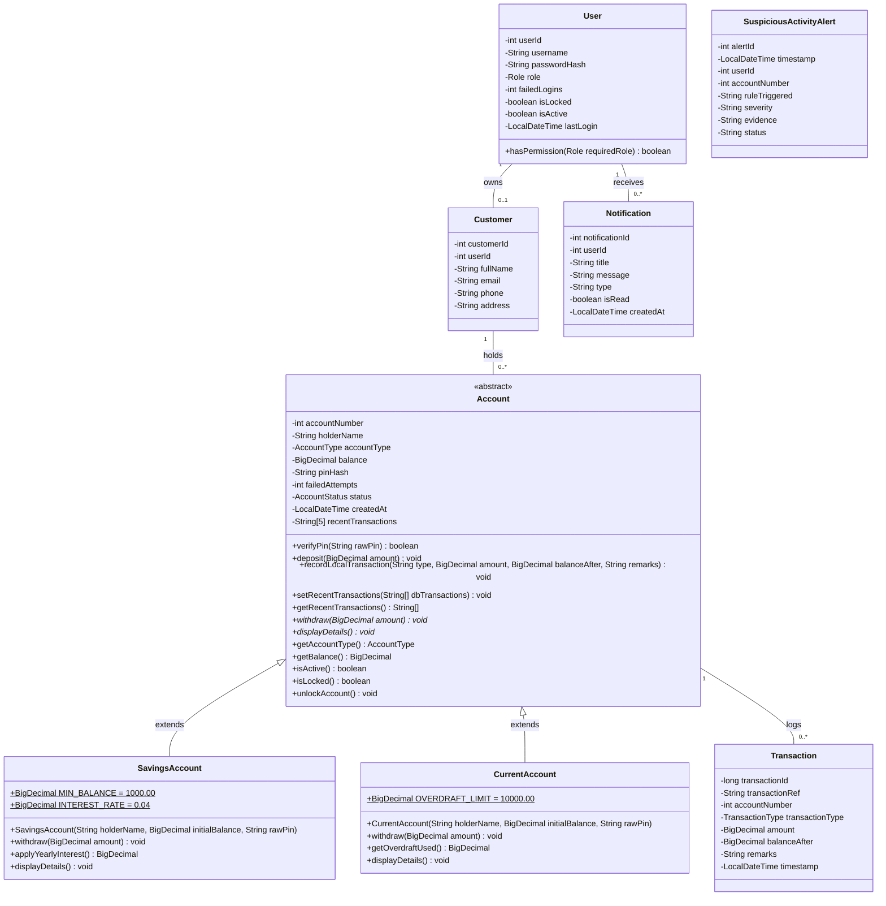
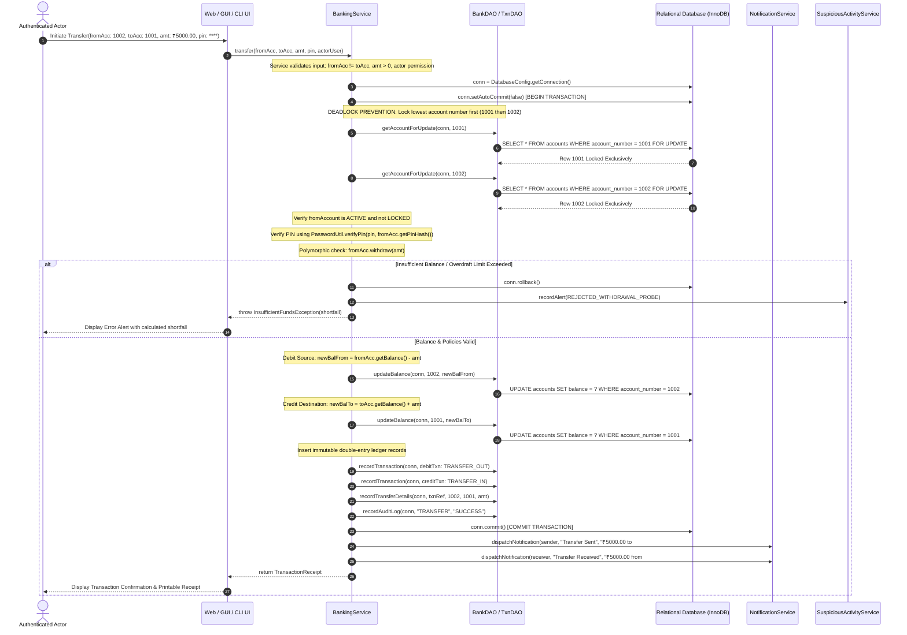
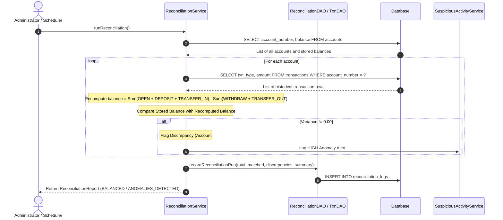
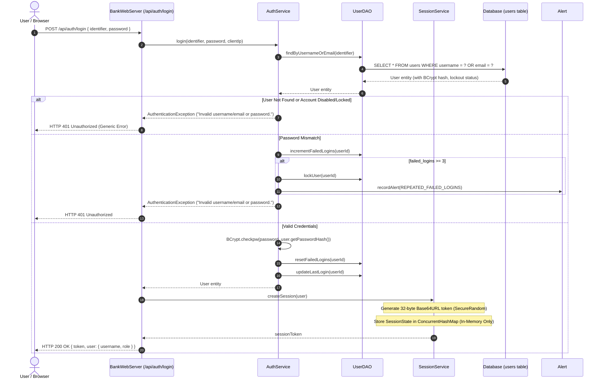
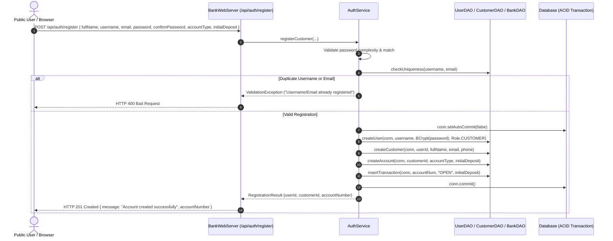
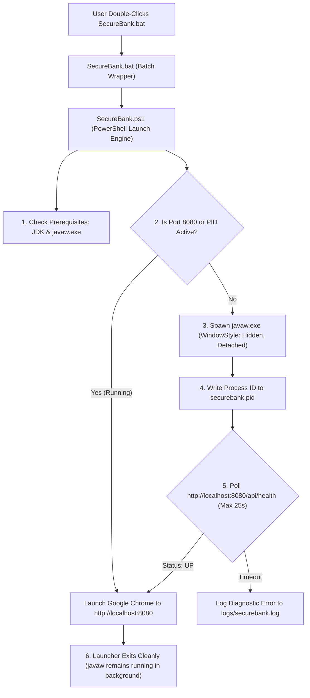

# SecureBank: Software Architecture & Technical Design Document

This document provides a comprehensive architectural specification of the **SecureBank** core banking management system for university capstone evaluation.

---

## 1. High-Level Architecture & Layered Pattern

SecureBank adopts a classical **4-Tier Layered Architecture** with an embedded asynchronous automation subsystem ensuring strict separation of concerns, high cohesion, loose coupling, and defensive security.

```mermaid
graph TD
    subgraph Tier 1: Presentation Layer
        UI_WEB["Modern Neo-Bank Web App (Port 8080 - HTML5/CSS/JS)"]
        UI_GUI["Desktop Swing Application (BankGuiApp)"]
        UI_CLI["Authenticated Terminal Console (BankApp)"]
    end

    subgraph Tier 2: Service Layer (Business Rules & Automation)
        S_AUTH["AuthService (BCrypt verification, Lockout, Session)"]
        S_ACC["AccountService (Creation, Validation, Soft Closure)"]
        S_BANK["BankingService (ACID Transfers, Deposits, Withdrawals)"]
        S_RECON["ReconciliationService (Automated Ledger Auditing)"]
        S_FRAUD["SuspiciousActivityService (Velocity & Fraud Engine)"]
        S_REPORT["ReportService (Turnover Summaries & RFC 4180 CSV)"]
        S_BACKUP["BackupService (Verified SQL Dumps & Retention)"]
        S_NOTIF["NotificationService (Event-Driven Customer Queue)"]
        S_SCHED["BankingSchedulerService (Periodic Background Tasks)"]
    end

    subgraph Tier 3: Data Access Object (DAO) Layer
        DAO_USER["UserDAO (Credentials & Lockout States)"]
        DAO_CUST["CustomerDAO (Demographics & Profiles)"]
        DAO_BANK["BankDAO (Account Balances, Status & Row Locks)"]
        DAO_TXN["TransactionDAO (Financial Ledger Entries)"]
        DAO_AUDIT["AuditDAO (Security Event Log Records)"]
        DAO_NOTIF["NotificationDAO (Customer Notification Records)"]
        DAO_FRAUD["SuspiciousAlertDAO (Security Incident Records)"]
        DAO_RECON["ReconciliationDAO (Ledger Audit History)"]
        DAO_SCHED["SchedulerDAO (Job Telemetry Records)"]
    end

    subgraph Tier 4: Persistence Layer
        DB_MYSQL[("Production MySQL 8.0+ Database")]
        DB_H2[("Zero-Setup Embedded H2 (MySQL Mode)")]
        DBCFG["DatabaseConfig (Dynamic Fallback & Connection Management)"]
    end

    UI_WEB --> S_AUTH
    UI_WEB --> S_ACC
    UI_WEB --> S_BANK
    UI_WEB --> S_RECON
    UI_WEB --> S_FRAUD
    UI_WEB --> S_REPORT
    UI_WEB --> S_BACKUP
    UI_WEB --> S_NOTIF

    UI_GUI --> S_AUTH
    UI_GUI --> S_ACC
    UI_GUI --> S_BANK
    UI_CLI --> S_AUTH
    UI_CLI --> S_ACC
    UI_CLI --> S_BANK

    S_BANK --> S_FRAUD
    S_BANK --> S_NOTIF
    S_AUTH --> S_FRAUD
    S_AUTH --> S_NOTIF
    S_ACC --> S_NOTIF
    S_SCHED --> S_RECON
    S_SCHED --> S_BACKUP

    S_AUTH --> DAO_USER
    S_AUTH --> DAO_AUDIT
    S_ACC --> DAO_BANK
    S_ACC --> DAO_CUST
    S_ACC --> DAO_AUDIT
    S_BANK --> DAO_BANK
    S_BANK --> DAO_TXN
    S_BANK --> DAO_AUDIT
    S_RECON --> DAO_RECON
    S_RECON --> DAO_BANK
    S_RECON --> DAO_TXN
    S_FRAUD --> DAO_FRAUD
    S_NOTIF --> DAO_NOTIF
    S_SCHED --> DAO_SCHED

    DAO_USER --> DBCFG
    DAO_CUST --> DBCFG
    DAO_BANK --> DBCFG
    DAO_TXN --> DBCFG
    DAO_AUDIT --> DBCFG
    DAO_NOTIF --> DBCFG
    DAO_FRAUD --> DBCFG
    DAO_RECON --> DBCFG
    DAO_SCHED --> DBCFG

    DBCFG --> DB_MYSQL
    DBCFG -.->|Offline Fallback| DB_H2
```

---

## 2. Object-Oriented Domain Hierarchy



---

## 3. Financial Transaction Workflows & Concurrency Control

### 3.1 Inter-Account Fund Transfer (Deadlock-Free ACID Sequence)

When transferring funds from Account A to Account B, if another concurrent thread simultaneously transfers funds from Account B to Account A, acquiring locks in arbitrary order causes a classic **Distributed Dining Philosophers Deadlock**.

**Deadlock-Safe Ordered Locking Algorithm:**
```java
// SecureBank BankDAO.java ordered locking:
int firstAcc = Math.min(senderAccNo, receiverAccNo);
int secondAcc = Math.max(senderAccNo, receiverAccNo);

Account lock1 = getAccountForUpdate(conn, firstAcc);
Account lock2 = getAccountForUpdate(conn, secondAcc);
```



---

## 4. Automated Transaction Reconciliation Sequence



---

## 5. User Interface Architecture

SecureBank provides three user interfaces:

1. **Modern Neo-Bank Web Application (`http://localhost:8080`)**:
   - Modern glassmorphism UI styled with CSS variables and gradients.
   - Real-time notification drawer with live unread badge.
   - Dedicated role-based views for Customer, Teller, and Administrator.
   - Live reconciliation triggers, RFC 4180 CSV report downloads, and one-click database backups.
2. **Java Swing Desktop GUI (`BankGuiApp`)**:
   - Native Look-and-Feel desktop graphical interface.
   - Role-specific tabbed panels, PIN masking, and printable receipt preview modals.
3. **Authenticated Terminal CLI (`BankApp`)**:
   - Standalone text-based terminal interface for headless servers or automated scripts.
   - Formatted monetary tables and interactive menus.

---

## 6. Real Authentication, Registration & Session Architecture

### 6.1 Real Database Authentication Flow


### 6.2 Atomic Customer Registration Flow


### 6.3 In-Memory Session Security Specification
- **Token Generation**: 32 bytes of cryptographic entropy sourced from `java.security.SecureRandom`, encoded using URL-safe Base64 without padding.
- **Storage Policy**: Stored exclusively in server-side `ConcurrentHashMap<String, SessionState>`. Never persisted to database or disk.
- **Sliding Timeout**: 15 minutes of inactivity (`IDLE_TIMEOUT_MILLIS = 15 * 60 * 1000L`). Valid requests update `lastAccessTime`.
- **Zero LocalStorage Policy**: Client web application retains token strictly in JavaScript runtime memory (`sessionState.token`), preventing persistent token theft via XSS or disk inspection.
- **Explicit Invalidation**: Calling `/api/auth/logout` completely deletes the session entry from server memory.

---

## 7. One-Click Windows Background Startup Architecture



### Startup Architecture Safeguards
1. **Console Suppression**: Using `javaw.exe` rather than `java.exe` prevents any black terminal console from displaying on the user's desktop.
2. **Deterministic PID Verification**: `securebank.pid` stores the background process ID. `Stop-SecureBank.bat` verifies the process command line signature before termination to avoid touching unrelated Java workloads.
3. **Health-Gated Browser Launch**: Chrome is launched only after `/api/health` returns HTTP 200 with `status: "UP"`, guaranteeing that the user never encounters a "Site Cannot Be Reached" error.

