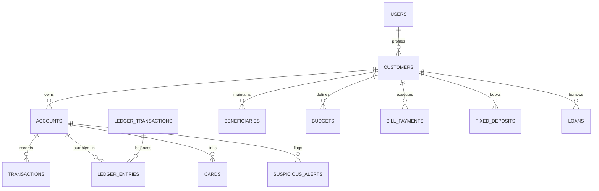

# SecureBank: Enterprise Banking System Architecture & Evaluation Guide

## 1. Executive Overview & Problem Statement
SecureBank is an enterprise-grade, database-driven core banking management system developed in Java. Traditional academic banking applications frequently suffer from critical architectural weaknesses:
- Financial state stored merely as an isolated numeric column prone to race conditions and phantom updates.
- Inability to mathematically audit money flows due to absence of double-entry accounting.
- Naive, hardcoded mock responses for sensitive banking modules (loans, fixed deposits, utility billers, debit cards).
- Security vulnerabilities such as Broken Object Level Authorization (IDOR), plaintext password fallbacks, and missing idempotency controls.

SecureBank resolves these fundamental flaws through an authoritative **Double-Entry General Ledger**, an **Explainable Rule-Based Fraud Detection & Risk Scoring Engine**, an automated **Financial Integrity Monitor & Reconciliation Engine**, and **Smart Spending Analytics**.

---

## 2. Technology Stack & Architectural Topology
- **Core Runtime**: Java 17 LTS (Pure Java HTTP Server, zero heavy framework dependencies).
- **Database Access Layer**: Raw JDBC with `java.sql.PreparedStatement`, explicit transaction control (`setAutoCommit(false)`, `commit()`, `rollback()`), row-level pessimistic locking (`SELECT ... FOR UPDATE`), and ACID guarantees.
- **Relational Databases Supported**:
  - **Primary**: MySQL 8.0+
  - **Development / In-Memory Automated Testing**: H2 Database (with MySQL compatibility mode).
- **Security & Cryptography**: BCrypt (`at.favre.lib.bcrypt`), PBKDF2/SHA-512, cryptographic tokenized JSON parser, strict role-based access control (RBAC), and session expiration lifecycle.
- **Frontend Layer**: Modern, responsive HTML5, Vanilla CSS3 (with CSS Custom Properties design system, glassmorphism, responsive data tables), and asynchronous Vanilla JavaScript (Fetch API with Bearer token interceptor).

---

## 3. Object-Oriented Programming (OOP) Architecture

SecureBank strictly adheres to fundamental Object-Oriented Principles across its domain model, service layer, and persistence boundaries:

### 3.1 Encapsulation
- **Data Protection**: All sensitive entity fields (e.g., `balance`, `pinHash`, `passwordHash`, `accountNumber`, `riskScore`) are declared `private` or `protected`.
- **Domain Invariants**: Financial state modifications are only permitted through controlled methods (e.g., `Account.deposit()`, `Account.withdraw()`).
- **Precision Integrity**: Money is represented strictly as immutable `java.math.BigDecimal` with explicit scale (2 decimal places) and `RoundingMode.HALF_EVEN` / `HALF_UP` to prevent floating-point inaccuracy.

### 3.2 Inheritance
- **Account Hierarchy**:
  - `Account` (Base abstract entity containing `accountNumber`, `balance`, `status`, `createdAt`, `updatedAt`, `customerId`, `pinHash`).
    - `SavingsAccount`: Extends `Account` with savings interest calculation (`interestRate`, minimum balance requirements of ₹1,000, and quarterly interest simulation).
    - `CurrentAccount`: Extends `Account` with commercial overdraft limits (`overdraftLimit` of ₹25,000 and business transaction policies).

### 3.3 Abstraction
- Clear separation between contracts and implementations:
  - `BankDAOInterface` defines the core banking persistence contract implemented by `BankDAO`.
  - Service facades (`BankingService`, `LedgerService`, `FraudEngineService`, `SpendingAnalyticsService`, `BankingModulesService`) abstract database transaction management and validation away from the HTTP presentation controllers.

### 3.4 Polymorphism
- Dynamic method dispatch in account transactions:
  - Both `SavingsAccount` and `CurrentAccount` override withdrawal evaluation rules polymorphically to enforce account-specific overdraft or minimum balance boundaries.
  - Polymorphic transaction processing routes different transaction types (`DEPOSIT`, `WITHDRAW`, `TRANSFER`, `BILL_PAYMENT`, `LOAN_DISBURSEMENT`, `FIXED_DEPOSIT_CREATION`) through dedicated balance and ledger posting rules.

### 3.5 Separation of Concerns & Exception Handling
- **Layers**:
  1. `com.securebank.ui.web.BankWebServer`: HTTP request handling, session authentication, input sanitization, and JSON response serialization.
  2. `com.securebank.service.*`: Business logic, domain invariants, RBAC authorization, and transaction orchestration.
  3. `com.securebank.dao.*`: Authoritative SQL execution, row mapping, and relational persistence.
  4. `com.securebank.model.*`: Domain entities.
  5. `com.securebank.exception.*`: Rich domain exception hierarchy (`InsufficientFundsException`, `InactiveAccountException`, `InvalidPinException`, `AccountNotFoundException`, `DuplicateTransactionException`).

---

## 4. Database Architecture & Double-Entry General Ledger

### 4.1 Authoritative Double-Entry Model
Unlike basic CRUD apps that merely update an account's balance column, SecureBank pairs every financial movement with an atomic, balanced record in the double-entry general ledger:
$$\sum \text{Debits} = \sum \text{Credits}$$

- **`ledger_transactions`**: Encapsulates the financial event (`transaction_ref`, `transaction_type`, `description`, `status`, `created_at`).
- **`ledger_entries`**: Stores balancing debits and credits (`account_id`, `entry_type` [DEBIT/CREDIT], `amount`).
- **Central Clearing Vault (`Account #0`)**:
  - **Customer Cash Deposit**: Debit Vault Cash (Asset) | Credit Customer Account (Liability).
  - **Customer Cash Withdrawal**: Debit Customer Account (Liability) | Credit Vault Cash (Asset).
  - **Inter-Account Transfer**: Debit Sender Account | Credit Receiver Account.
  - **Loan Disbursement**: Debit Vault Principal (Asset) | Credit Customer Deposit (Liability).

### 4.2 Relational Entity-Relationship (ER) Schema

### 4.3 ACID Guarantees & Concurrency Control
- **Atomicity & Rollback**: Transfers and multi-leg financial operations use `connection.setAutoCommit(false)`. If any step fails (e.g., invalid destination, database exception, constraint violation), `connection.rollback()` is invoked, leaving no partial state.
- **Pessimistic Row Locking (`SELECT ... FOR UPDATE`)**: Concurrent withdrawals or transfers acquire pessimistic row locks on affected accounts.
- **Deadlock Prevention Ordering**: To prevent database deadlocks during concurrent bi-directional transfers (e.g., Account A $\rightarrow$ Account B while Account B $\rightarrow$ Account A), locks are always acquired in deterministic numerical order:
  $$\min(\text{fromAcc}, \text{toAcc}) \quad \text{then} \quad \max(\text{fromAcc}, \text{toAcc})$$
- **Idempotency Protection**: `idempotency_keys` table enforces request payload uniqueness using database-enforced unique constraints, completely eliminating duplicate financial charges.

---

## 5. Innovation Modules

### 5.1 Innovation 1: Explainable Rule-Based Fraud Detection & Risk Engine
- Implemented in `FraudEngineService` and `SuspiciousActivityService`.
- **Configurable Deterministic Rules**:
  1. `HIGH_VALUE_TRANSACTION`: Flags transactions exceeding ₹50,000.00 (+40 risk points).
  2. `CRITICAL_VALUE_OUTLIER`: Flags transactions exceeding ₹2,00,000.00 (+60 risk points).
  3. `RAPID_TRANSACTION_BURST`: Detects velocity bursts exceeding 5 transactions within a 10-minute window (+25 risk points).
  4. `UNUSUAL_NIGHT_TRANSACTION`: Identifies sensitive transfers executed during off-hours (00:00–05:00) (+20 risk points).
  5. `REPEATED_FAILED_LOGINS`: Flags authentication lockouts exceeding 3 consecutive failed attempts (+35 risk points).
  6. `UNAUTHORIZED_ACCESS_ATTEMPT`: Critical alert when a user attempts IDOR bypass (+50 risk points).
- **Explainability**: Every alert includes a composite human-readable explanation, specific risk score (0–100), rule version, and cryptographic event evidence.
- **SIEM Resolution**: Administrators can investigate open alerts, review evidence, and record resolution decisions.

### 5.2 Innovation 2: Financial Integrity Monitor (Automated Reconciliation)
- Implemented in `ReconciliationService` and `LedgerService`.
- **Audit Methodology**:
  - Recomputes the mathematically expected account balance from historical double-entry journal entries.
  - Compares computed ledger balances against stored current balances.
  - Audits the General Ledger to ensure all `ledger_transactions` satisfy Total Debits == Total Credits.
  - Automatically records discrepancies in the `reconciliation_logs` table without fabricating fixes.
  - Exposes an interactive General Ledger Audit modal in the Administrator portal.

### 5.3 Innovation 3: Smart Spending Insights & Budgets
- Implemented in `SpendingAnalyticsService` and `BudgetDAO`.
- **Categorization Engine**: Automatically classifies transaction remarks and counterparty data into standard categories (`FOOD`, `TRANSPORT`, `SHOPPING`, `UTILITIES`, `ENTERTAINMENT`, `EDUCATION`, `HEALTH`, `OTHER`).
- **Real-Time Analytics**:
  - Evaluates monthly inflow vs. monthly outflow.
  - Calculates dynamic customer savings rate percentage:
    $$\text{Savings Rate} = \frac{\text{Total Inflow} - \text{Total Outflow}}{\text{Total Inflow}} \times 100\%$$
  - Tracks real-time budget utilization percentages against customer-defined budgets.
  - Displays interactive visual analytics on the Customer Dashboard.

---

## 6. Extended Banking Modules
1. **Beneficiary Management**: Allows customers to register trusted payees with specific per-transaction limits, IFSC routing, and customer ownership validation.
2. **Utility Bill Payments**: Real database-driven biller registry (Electricity, Water, Gas, Fiber) with consumer reference validation, atomic balance debits, receipt generation, and general ledger journal postings.
3. **High-Yield Fixed Deposits**: Creation of term deposits with quarterly compound interest calculations, maturity projections, and premature liquidation workflows.
4. **Loan Management**: Multi-step personal and home loan workflows with EMI calculation formula:
   $$\text{EMI} = \frac{P \times r \times (1+r)^n}{(1+r)^n - 1}$$
   Includes application, review, approval, disbursement into customer accounts, and repayment schedules.
5. **Virtual Platinum Debit Card Controls**: Self-service card freeze/unfreeze, ATM and POS daily withdrawal limit adjustments, and contactless NFC toggle.

---

## 7. Known Architectural Limitations & Boundaries
- **Simulated Payment Gateways**: Utility billers, cards, and loan credit scoring execute as self-contained internal core banking simulations; external third-party payment rails (e.g., NPCI UPI, Visa/Mastercard Interchange) are simulated internally.
- **SMS / Email Gateway**: 2FA OTP codes and alert notifications log to the application console and audit register; production deployment requires integration with a cloud SMS/Email provider.
