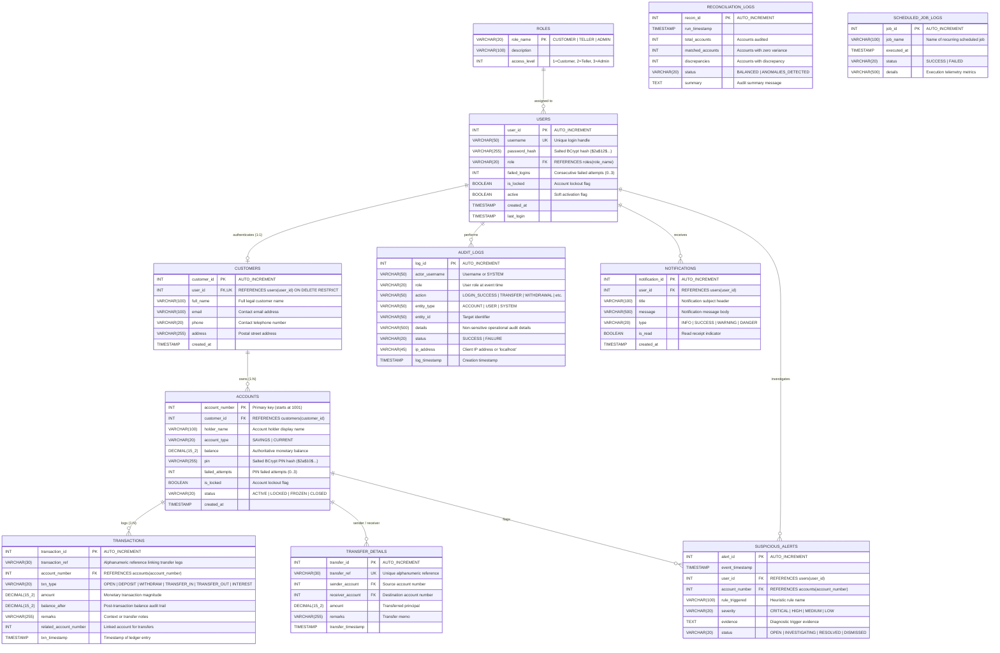

# SecureBank: Database Design & Relational Persistence Specification

This document details the database schema, relational normalization, data integrity constraints, indexing strategies, and ACID transaction models of the **SecureBank** relational database (`securebank_db`).

---

## 1. Entity-Relationship Diagram (ERD)

The database schema is designed in Third Normal Form (3NF) to eliminate data redundancy while enforcing strict referential integrity.

---

## 2. Table Specifications & Data Dictionary

### 2.1 Table: `users`
Stores system authentication credentials, security lockout flags, and audit timestamps.
- **`user_id`**: `INT AUTO_INCREMENT PRIMARY KEY`
- **`username`**: `VARCHAR(50) NOT NULL UNIQUE`
- **`password_hash`**: `VARCHAR(255) NOT NULL` (BCrypt string with embedded 128-bit salt and work factor 12)
- **`role`**: `VARCHAR(20) NOT NULL DEFAULT 'CUSTOMER'`
- **`failed_logins`**: `INT NOT NULL DEFAULT 0`
- **`is_locked`**: `BOOLEAN NOT NULL DEFAULT FALSE`
- **`active`**: `BOOLEAN NOT NULL DEFAULT TRUE`
- **`created_at`**: `TIMESTAMP DEFAULT CURRENT_TIMESTAMP`
- **`last_login`**: `TIMESTAMP NULL`

### 2.2 Table: `customers`
Stores customer personal profile information linked to user credentials.
- **`customer_id`**: `INT AUTO_INCREMENT PRIMARY KEY`
- **`user_id`**: `INT NOT NULL UNIQUE`, Foreign Key references `users(user_id)`
- **`full_name`**: `VARCHAR(100) NOT NULL`
- **`email`**: `VARCHAR(100)`
- **`phone`**: `VARCHAR(20)`
- **`address`**: `VARCHAR(255)`
- **`created_at`**: `TIMESTAMP DEFAULT CURRENT_TIMESTAMP`

### 2.3 Table: `accounts`
Stores authoritative account master records, account types, balances, and status flags.
- **`account_number`**: `INT AUTO_INCREMENT PRIMARY KEY` (Starts at 1001)
- **`customer_id`**: `INT`, Foreign Key references `customers(customer_id)`
- **`holder_name`**: `VARCHAR(100) NOT NULL`
- **`account_type`**: `VARCHAR(20) NOT NULL` (`SAVINGS`, `CURRENT`)
- **`balance`**: `DECIMAL(15, 2) NOT NULL DEFAULT 0.00`
- **`pin`**: `VARCHAR(255) NOT NULL` (Salted BCrypt PIN hash, cost factor 10)
- **`failed_attempts`**: `INT NOT NULL DEFAULT 0`
- **`is_locked`**: `BOOLEAN NOT NULL DEFAULT FALSE`
- **`status`**: `VARCHAR(20) NOT NULL DEFAULT 'ACTIVE'` (`ACTIVE`, `LOCKED`, `FROZEN`, `CLOSED`)
- **`created_at`**: `TIMESTAMP DEFAULT CURRENT_TIMESTAMP`

### 2.4 Table: `transactions`
Immutable, append-only double-entry financial ledger records.
- **`transaction_id`**: `INT AUTO_INCREMENT PRIMARY KEY`
- **`transaction_ref`**: `VARCHAR(30)` (Alphanumeric reference linking transfer legs)
- **`account_number`**: `INT NOT NULL`, Foreign Key references `accounts(account_number)`
- **`txn_type`**: `VARCHAR(20) NOT NULL` (`OPEN`, `DEPOSIT`, `WITHDRAW`, `TRANSFER_IN`, `TRANSFER_OUT`, `INTEREST`)
- **`amount`**: `DECIMAL(15, 2) NOT NULL`
- **`balance_after`**: `DECIMAL(15, 2) NOT NULL`
- **`remarks`**: `VARCHAR(255) NOT NULL`
- **`related_account_number`**: `INT NULL`
- **`txn_timestamp`**: `TIMESTAMP DEFAULT CURRENT_TIMESTAMP`

### 2.5 Table: `transfer_details`
Double-entry linkage table tracking end-to-end transfers between accounts.
- **`transfer_id`**: `INT AUTO_INCREMENT PRIMARY KEY`
- **`transfer_ref`**: `VARCHAR(30) NOT NULL UNIQUE`
- **`sender_account`**: `INT NOT NULL`
- **`receiver_account`**: `INT NOT NULL`
- **`amount`**: `DECIMAL(15, 2) NOT NULL`
- **`remarks`**: `VARCHAR(255)`
- **`transfer_timestamp`**: `TIMESTAMP DEFAULT CURRENT_TIMESTAMP`

### 2.6 Table: `audit_logs`
Immutable compliance and cybersecurity audit trail.
- **`log_id`**: `INT AUTO_INCREMENT PRIMARY KEY`
- **`actor_username`**: `VARCHAR(50) NOT NULL`
- **`role`**: `VARCHAR(20)`
- **`action`**: `VARCHAR(50) NOT NULL`
- **`entity_type`**: `VARCHAR(50)`
- **`entity_id`**: `VARCHAR(50)`
- **`details`**: `VARCHAR(500)`
- **`status`**: `VARCHAR(20) NOT NULL DEFAULT 'SUCCESS'`
- **`ip_address`**: `VARCHAR(45) DEFAULT 'LOCAL'`
- **`log_timestamp`**: `TIMESTAMP DEFAULT CURRENT_TIMESTAMP`

### 2.7 Table: `notifications`
Customer and staff event-driven notification queue.
- **`notification_id`**: `INT AUTO_INCREMENT PRIMARY KEY`
- **`user_id`**: `INT NOT NULL`, references `users(user_id)`
- **`title`**: `VARCHAR(100) NOT NULL`
- **`message`**: `VARCHAR(500) NOT NULL`
- **`type`**: `VARCHAR(20) NOT NULL DEFAULT 'INFO'`
- **`is_read`**: `BOOLEAN NOT NULL DEFAULT FALSE`
- **`created_at`**: `TIMESTAMP DEFAULT CURRENT_TIMESTAMP`

### 2.8 Table: `suspicious_alerts`
Security and fraud incident monitoring log.
- **`alert_id`**: `INT AUTO_INCREMENT PRIMARY KEY`
- **`event_timestamp`**: `TIMESTAMP DEFAULT CURRENT_TIMESTAMP`
- **`user_id`**: `INT NULL`
- **`account_number`**: `INT NULL`
- **`rule_triggered`**: `VARCHAR(100) NOT NULL`
- **`severity`**: `VARCHAR(20) NOT NULL` (`CRITICAL`, `HIGH`, `MEDIUM`, `LOW`)
- **`evidence`**: `TEXT NOT NULL`
- **`status`**: `VARCHAR(20) NOT NULL DEFAULT 'OPEN'`

### 2.9 Table: `reconciliation_logs`
Historical records of automated ledger reconciliation runs.
- **`recon_id`**: `INT AUTO_INCREMENT PRIMARY KEY`
- **`run_timestamp`**: `TIMESTAMP DEFAULT CURRENT_TIMESTAMP`
- **`total_accounts`**: `INT NOT NULL`
- **`matched_accounts`**: `INT NOT NULL`
- **`discrepancies`**: `INT NOT NULL`
- **`status`**: `VARCHAR(20) NOT NULL` (`BALANCED`, `ANOMALIES_DETECTED`)
- **`summary`**: `TEXT NOT NULL`

### 2.10 Table: `scheduled_job_logs`
Telemetry logging for background scheduler executions.
- **`job_id`**: `INT AUTO_INCREMENT PRIMARY KEY`
- **`job_name`**: `VARCHAR(100) NOT NULL`
- **`executed_at`**: `TIMESTAMP DEFAULT CURRENT_TIMESTAMP`
- **`status`**: `VARCHAR(20) NOT NULL` (`SUCCESS`, `FAILED`)
- **`details`**: `VARCHAR(500)`

---

## 3. Indexing & Performance Optimization

To guarantee sub-millisecond query response times under high concurrency, the following B-Tree indexes are enforced:

| Index Name | Target Table | Indexed Column(s) | Optimization Goal |
| :--- | :--- | :--- | :--- |
| `idx_users_username` | `users` | `username` | $O(1)$ fast lookups during authentication |
| `idx_customers_user` | `customers` | `user_id` | Foreign-key join speed for customer profiles |
| `idx_accounts_cust` | `accounts` | `customer_id` | Fast retrieval of customer account portfolios |
| `idx_accounts_status`| `accounts` | `status` | Rapid filtering of active vs locked/closed accounts |
| `idx_txn_acc_time` | `transactions` | `(account_number, txn_timestamp DESC)` | High-performance mini-statement generation |
| `idx_txn_ref` | `transactions` | `transaction_ref` | Fast receipt and transaction tracing |
| `idx_transfer_ref` | `transfer_details` | `transfer_ref` | Enforces double-entry transfer uniqueness |
| `idx_notif_user` | `notifications` | `(user_id, is_read)` | Instant retrieval of unread notifications for badge counts |
| `idx_alerts_status`| `suspicious_alerts` | `status` | Rapid loading of open security alerts for Admin dashboard |

---

## 4. ACID Transaction Boundaries & Row Locking

SecureBank mandates InnoDB in MySQL (or embedded H2 in MySQL compatibility mode) to enforce ACID properties:

1. **Atomicity**: Transfers debit source, credit receiver, record dual transactions, and record transfer details in a single atomic transaction. Any error triggers `conn.rollback()`.
2. **Consistency**: Database constraints enforce `amount > 0`, `balance >= minimum` (Savings) or `balance >= -overdraft` (Current).
3. **Isolation**: High-concurrency operations execute with `SELECT ... FOR UPDATE` row-level locks. Account locks are acquired strictly in increasing order (`min(acc1, acc2)` followed by `max(acc1, acc2)`) to eliminate database deadlocks.
4. **Durability**: Committed transactions are permanently written to write-ahead logs and survive unexpected system termination.
