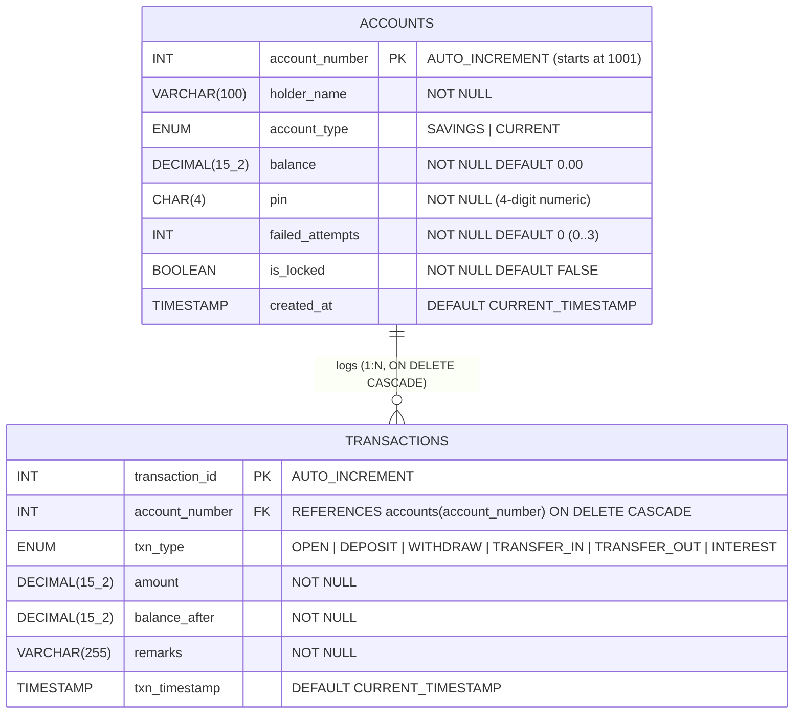
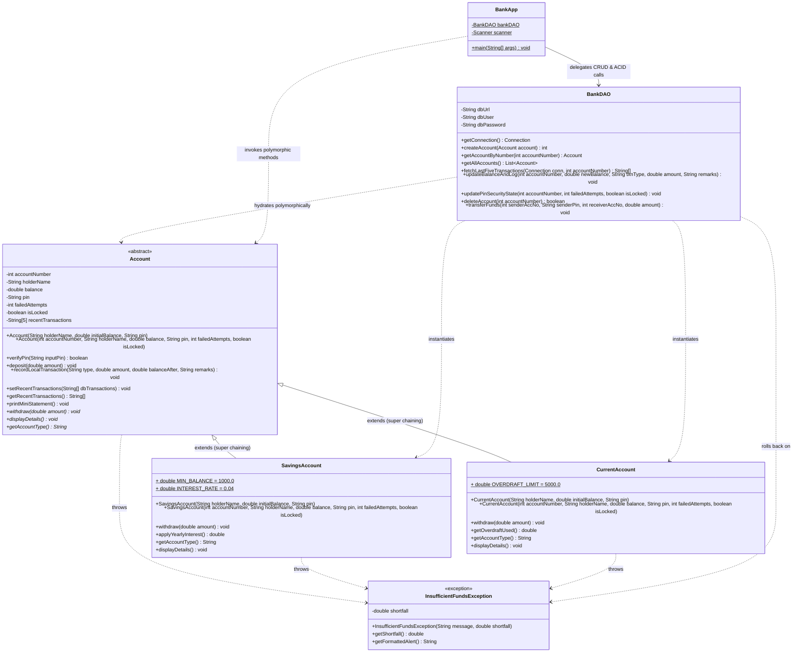

# SecureBank: Role-Based Core Banking & Transaction Management System
**Architecture Diagrams, 4-Member Team Role Distribution & Viva-Voce Preparation Guide**

## 1. Entity-Relationship (ER) Diagram (`securebank_db`)

The MySQL relational schema enforces a strict **1:N (One-to-Many)** relationship between `accounts` and `transactions` with `ON DELETE CASCADE` referential integrity and `InnoDB` ACID transaction support.



## 2. UML Class Diagram (OOP Hierarchy & JDBC DAO Layer)

The class architecture separates domain modeling (`Account` abstract base class, `SavingsAccount`, `CurrentAccount`, `InsufficientFundsException`) from persistence (`BankDAO`) and presentation (`BankApp`).



## 3. Four-Member Capstone Team Role Distribution

| Member | Assigned Role | Primary Modules & Files Owned | Core OOP & DBMS Responsibilities | Viva Focus Areas |
| :--- | :--- | :--- | :--- | :--- |
| **Member 1** | **Core OOP Domain Architect** | `Account.java`, `InsufficientFundsException.java` | Design the abstract `Account` superclass, enforce strict `private` field encapsulation, implement the 4-digit PIN lockout state machine (`failedAttempts` & `isLocked`), manage the fixed-size `String[5]` circular transaction buffer, and build the custom checked `InsufficientFundsException` with `shortfall` calculation. | Abstraction, Encapsulation, Checked vs. Unchecked Exceptions, Fixed-Size 1D Arrays |
| **Member 2** | **Polymorphism & Business Rules Engineer** | `SavingsAccount.java`, `CurrentAccount.java` | Implement constructor chaining via `super()`, override `withdraw(double)` and `displayDetails()` polymorphically, enforce `MIN_BALANCE = 1000.0` and `applyYearlyInterest()` (`0.04`) in `SavingsAccount`, and implement `OVERDRAFT_LIMIT = 5000.0` (down to `-5000.0`) in `CurrentAccount`. | Inheritance, `super` Keyword, Runtime Polymorphism, `static final` Constants |
| **Member 3** | **DBMS Architect & SQL Designer** | `schema.sql`, ER Diagram | Design the `securebank_db` relational schema (`accounts` and `transactions` tables), configure `AUTO_INCREMENT = 1001`, define `ENUM` and `CHECK` constraints, establish the `1:N` foreign key with `ON DELETE CASCADE`, create composite indexes for the 5-transaction query, and author realistic seed data. | Primary/Foreign Keys, `ON DELETE CASCADE`, `DECIMAL` vs. `DOUBLE`, Indexing, 3NF Normalization |
| **Member 4** | **JDBC Persistence & ACID Transaction Lead** | `BankDAO.java`, `BankApp.java`, Terminal UI | Implement the Data Access Object (`BankDAO`) using `PreparedStatement` for all 4 CRUD operations, orchestrate ACID atomic fund transfers (`setAutoCommit(false)`, `commit()`, `rollback()`, `SELECT ... FOR UPDATE`), and integrate the console menu (`BankApp`) and terminal UI. | JDBC Architecture, SQL Injection Prevention, ACID Properties, Transaction Rollback |

## 4. Ten Expected Viva-Voce Questions & Concise Answers

1. **Why is `Account` declared as an `abstract` class rather than a concrete class or an interface?**
   - **Answer:** In real-world banking, a generic "Account" cannot exist without a specific product type (`SAVINGS` or `CURRENT`). Declaring `Account` as `abstract` prevents direct instantiation (`new Account()` is a compile-time error) while allowing shared state (`accountNumber`, `balance`, `pin`, `recentTransactions`) and shared concrete behavior (`verifyPin()`, `deposit()`) to be inherited—something a pure Java interface cannot hold with private instance fields.

2. **How does runtime polymorphism (dynamic method dispatch) work when `acc.withdraw(amount)` is called in `BankApp` or `BankDAO`?**
   - **Answer:** `BankDAO.getAccountByNumber()` returns an `Account` reference pointing to either a `SavingsAccount` or `CurrentAccount` heap instance based on the `account_type` column in MySQL. At runtime, the JVM looks up the actual object's vtable and invokes `SavingsAccount.withdraw()` (enforcing `MIN_BALANCE = 1000.0`) or `CurrentAccount.withdraw()` (allowing balance down to `-5000.0`) without the caller needing `if/else` type checks.

3. **Why does `InsufficientFundsException` extend `Exception` (checked) instead of `RuntimeException` (unchecked), and why store `shortfall`?**
   - **Answer:** Extending `Exception` makes it a **checked exception**, forcing every caller (`BankApp` and `BankDAO.transferFunds()`) at compile time to explicitly handle or declare business-rule violations via `try-catch` and trigger a database `rollback()`. Storing the `shortfall` field (`double`) quantifies the exact deficit (e.g., `Shortfall: Rs. 2,300.00`), giving the user actionable feedback rather than a generic error string.

4. **How is the fixed-size `String[5]` array managed for the mini-statement, and why use a fixed array instead of an `ArrayList`?**
   - **Answer:** Each `Account` object holds `private final String[] recentTransactions = new String[5]`. When a new local transaction is recorded, elements at indices `0..3` shift right by one position (`recentTransactions[i] = recentTransactions[i - 1]`) and the newest transaction is written at index `0`. When hydrating from MySQL, `SELECT ... ORDER BY txn_timestamp DESC LIMIT 5` populates up to 5 slots. A fixed `String[5]` array guarantees constant $O(1)$ bounded memory per account object.

5. **How does the 4-digit PIN security lockout work across both Java memory and MySQL persistence?**
   - **Answer:** Before any withdrawal, deposit, interest credit, or closure, `verifyPin(inputPin)` checks if `isLocked` is already `true`. If unlocked and the PIN mismatches, `failedAttempts` increments; upon reaching `3`, `isLocked` becomes `true`. Immediately after `verifyPin()`, `BankDAO.updatePinSecurityState()` persists `failed_attempts` and `is_locked` to MySQL so an attacker cannot bypass the 3-strike lockout by restarting the application.

6. **Why did you use `PreparedStatement` with `?` placeholders in `BankDAO` instead of `Statement` with string concatenation?**
   - **Answer:** `PreparedStatement` pre-compiles the SQL execution plan on the MySQL server and binds parameters strictly as typed literals (`setInt`, `setDouble`, `setString`). This completely prevents **SQL Injection** attacks (e.g., entering `' OR '1'='1` in `holder_name` or `pin`) and improves performance on repeated queries.

7. **Explain how `transferFunds()` guarantees ACID compliance during a crash or `InsufficientFundsException`.**
   - **Answer:** `transferFunds()` disables JDBC auto-commit via `conn.setAutoCommit(false)` and locks both rows using `SELECT ... FOR UPDATE` (Isolation). It then executes `sender.withdraw(amount)` and `receiver.deposit(amount)`, runs two `UPDATE accounts` statements, and inserts two `transactions` rows (`TRANSFER_OUT` and `TRANSFER_IN`). Only if all steps succeed does `conn.commit()` make changes permanent (Atomicity & Durability). If `InsufficientFundsException` or `SQLException` occurs at any point, the `catch` block executes `conn.rollback()`, restoring both balances to their exact pre-transfer state (Consistency).

8. **Why is the `balance` column in MySQL defined as `DECIMAL(15, 2)` instead of `FLOAT` or `DOUBLE`?**
   - **Answer:** `FLOAT` and `DOUBLE` use IEEE 754 binary floating-point representation, which cannot represent base-10 fractions like `0.10` or `0.04` exactly and introduces rounding drift over thousands of ledger entries. `DECIMAL(15, 2)` stores exact fixed-point base-10 values with 2 fractional digits for currency precision.

9. **What is the purpose of `ON DELETE CASCADE` on the `account_number` foreign key in the `transactions` table?**
   - **Answer:** `ON DELETE CASCADE` ensures **referential integrity**: when `BankDAO.deleteAccount(accountNumber)` deletes a parent row in `accounts`, MySQL automatically deletes all associated child transaction records in `transactions`, preventing orphan ledger rows without requiring a separate `DELETE FROM transactions` query in Java.

10. **Why is `applyYearlyInterest()` defined only in `SavingsAccount` and how do we invoke it when holding an `Account` reference?**
    - **Answer:** Under banking domain rules, Current accounts offer an overdraft facility (`Rs. 5,000`) rather than interest, whereas Savings accounts earn `4%` (`0.04`) yearly interest. Because `applyYearlyInterest()` is specific to `SavingsAccount`, `BankApp` checks `if (acc instanceof SavingsAccount)` and safely downcasts `((SavingsAccount) acc).applyYearlyInterest()` before persisting the `INTEREST` transaction via `BankDAO`.

## 5. Quick-Start Compilation & Execution Guide

1. **Initialize MySQL Database:**
   ```bash
   mysql -u root -p < schema.sql
   ```
2. **Compile All Java Classes:**
   ```bash
   javac InsufficientFundsException.java Account.java SavingsAccount.java CurrentAccount.java BankDAO.java BankApp.java
   ```
3. **Run Console Application (with MySQL Connector/J on classpath):**
   ```bash
   java -cp .:mysql-connector-j-8.4.0.jar BankApp
   ```
